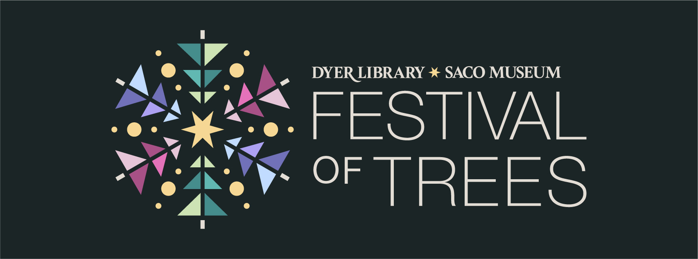

Let's just get this out of the way, up front. I want a little bit of your time and a little bit of your money. Fifty bucks, and a couple few hours. But it's for a good cause, and you get free drinks* and snacks. <i>Where?</i> At the Dyer Library and Saco Museum <a href="https://dyerlibrarysacomuseum.org/festival-of-trees/">Festival of Trees Preview Gala</a>. <i>Why there?</i> I am on the board of trustees, and this is our biggest fundraiser. Yes, I'm a little on the late side with asking you, I'll do better next year.

Here's my pitch. Libraries are awesome (museums are fine). From the Kellogg-Hubbard in Central Vermont, to the Cambridge Public Library, and now the Dyer Library, I've been happy to treat my local library as a <a href="https://en.wikipedia.org/wiki/Third_place">third space</a>. My kids are currently setting records in both voracity for books and late fees. Louise even found a book for her horny ladies book club. I'm sorry, erotic book club. The current administration even tried to revoke funding to the U.S. Institute of Museum and Library Services, so you know libraries must kick ass. So please buy a ticket and join Louise and I on a festive night for a great cause.

<a href="https://secure.lglforms.com/form_engine/s/CSXqmqPYCTKyR7TXHBquuQ" style="display:inline-block; padding:8px 16px; background:#0066cc; color:#fff; text-decoration:none; border-radius:4px;">
  Get Your Ticket
</a>

*Not too many drinks, you animals. This is usually a classy event, and I don't want to be the reason it's not this year.
